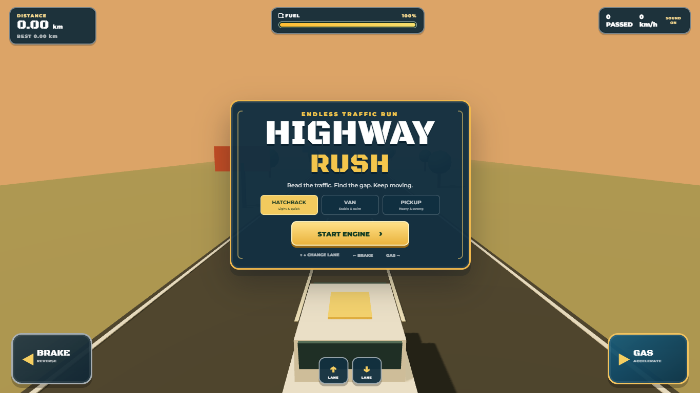

# Highway Rush

A 3D endless traffic game with a behind-the-car highway camera, responsive lane changing, varied traffic, and long-distance runs.



## Play locally

```bash
npm install
npm run dev
```

Then open the URL shown by Vite. Hold **Right Arrow**, **D**, or **Space** for gas. Hold **Left Arrow** or **A** to brake. Use **Up/Down Arrow** or **W/S** to change lanes.

## Highlights

- Full Three.js 3D scene with lighting, shadows, fog, moving scenery, and a chase camera
- Three-lane traffic with sedans, hatchbacks, vans, pickups, buses, semi-trucks, and motorcycles
- Acceleration, braking, drag, different vehicle handling, body roll, pitch, suspension movement, and wheel rotation
- Selectable hatchback, van, and pickup
- Closing-speed collisions, close-pass bonuses, fuel cans, and coins
- Responsive touch controls and keyboard support
- Installable PWA with offline caching and fullscreen landscape mode
- Zero-config Vite deployment on Vercel

## Production

```bash
npm run build
npm run preview
```

The production site is emitted to `dist/`. Import this repository into Vercel; framework detection and build settings work automatically.

## License

MIT
